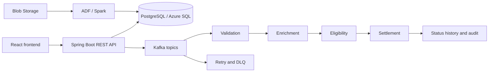

# Real-Time Trade Settlement Platform

Initial full-stack foundation using Java 11, Spring Boot, Maven, React, and Vite.

## Prerequisites

- JDK 11 or newer (the Maven compiler targets Java 11)
- Maven 3.6.3 or newer
- Node.js 20.19 or newer (or 22.12 or newer)
- npm 9 or newer

## Run the backend

```bash
cd backend
mvn spring-boot:run
```

The REST API starts at `http://localhost:8080`. Verify it with:

```bash
curl http://localhost:8080/api/status
```

## Run the frontend

In a second terminal:

```bash
cd frontend
npm install
npm run dev
```

Open `http://localhost:5173`. Vite proxies `/api` calls to the Spring Boot server.

## Build

```bash
cd backend
mvn clean verify

cd ../frontend
npm install
npm run build
```

See [docs/architecture/README.md](docs/architecture/README.md) for the system design
and the intended responsibilities of each package.

## Architecture and API

Trades enter through Spring Boot REST endpoints, are validated and persisted,
then flow through Kafka topics for enrichment, eligibility, settlement, status,
retry, and dead-letter processing. Spark jobs provide batch cleaning,
reference-data enrichment, and aggregation. React consumes the REST API for
submission, details, settlement status, failed trades, and transaction traces.



Key endpoints include `POST /api/trades`, `GET /api/trades/{id}` with
`/details` and `/status`, `GET /api/settlements`, `/api/failed-trades`, and
`/api/traces/{id}`. Health checks are available at `/api/status` and
`/actuator/health`. Production API requests require bearer authentication;
configure `VITE_API_BASE_URL` and `OIDC_ISSUER_URI`/`AZURE_TENANT_ID`.

### Sample trade request

Use the seeded active UUIDs from `V4__seed_reference_data.sql`:

```bash
curl -X POST http://localhost:8080/api/trades \
  -H 'Content-Type: application/json' \
  -d '{
    "tradeReference":"TRD-LOCAL-10001",
    "externalReference":"OMS-88421",
    "tradeType":"BUY",
    "instrumentId":"11111111-1111-4111-8111-111111111111",
    "buyerCounterpartyId":"aaaaaaaa-aaaa-4aaa-8aaa-aaaaaaaaaaaa",
    "sellerCounterpartyId":"bbbbbbbb-bbbb-4bbb-8bbb-bbbbbbbbbbbb",
    "quantity":1000,
    "price":125.75,
    "currencyCode":"USD",
    "tradeDate":"2026-10-27",
    "settlementDate":"2026-10-29"
  }'
```

Then query the returned UUID with `GET /api/trades/{id}`,
`GET /api/trades/{id}/status`, and `GET /api/traces/{id}`. Reference data is
available from `/api/reference-data/instruments` and
`/api/reference-data/counterparties`.

## Docker local environment

The complete local environment includes PostgreSQL, Kafka, the backend, and the
frontend:

```bash
docker compose up --build -d
docker compose ps
```

Open `http://localhost:5173` after all services become healthy. Detailed profile,
configuration, verification, troubleshooting, and shutdown instructions are in
[docs/deployment/local-development.md](docs/deployment/local-development.md).

## Azure deployment

Azure templates are under [infrastructure/azure](infrastructure/azure): Blob
and Azure SQL provisioning, Blob → Spark → SQL Data Factory processing, a Blob
trigger Function, App Service hosting, and Application Insights monitoring.
Follow [infrastructure/azure/DEPLOYMENT.md](infrastructure/azure/DEPLOYMENT.md)
for deployment and verification. Store passwords, OAuth values, Kafka
credentials, and storage keys in Key Vault or deployment secret settings.

## Verification and limitations

The frontend production build was executed with `npm run build` and passed.
Frontend Vitest was attempted but is blocked by a local esbuild/Vitest
access-denied config-resolution error. Spark tests were attempted but the
Windows Python launcher could not create its configured process. Backend Maven
tests/builds could not run because Maven is not installed on PATH.

Kafka, databases, Azure Blob/Data Factory/SQL, hosting, and complete end-to-end
settlement workflows require external services and credentials and have not
been claimed as verified here. Run the suites in `backend/src/test` and
`spark/tests`, and the Azure verification script, when those dependencies are
available.
